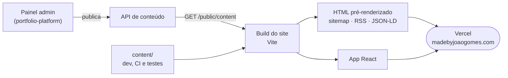

# Made by João Gomes

[](https://github.com/joaosamuelgomes/portfolio/actions/workflows/ci.yml)
[](https://sonarcloud.io/summary/new_code?id=joaosamuelgomes_portfolio)
[](https://sonarcloud.io/summary/new_code?id=joaosamuelgomes_portfolio)
[](https://joaosamuelgomes.github.io/portfolio/)

O portfólio de João Samuel Gomes em [madebyjoaogomes.com](https://madebyjoaogomes.com): um site em **React e TypeScript** que apresenta projetos reais, experiência e artigos, com o mesmo cuidado de produto, UX e engenharia que ele mostra.

Um portfólio também é um produto. Precisa carregar rápido, ser encontrado pelo Google, funcionar com teclado e leitor de tela e ser fácil de manter. Este repositório trata o site assim: tem design system documentado, testes de ponta a ponta com checagem de acessibilidade, SEO pré-renderizado e conteúdo separado do código.

## Em produção

| | |
| --- | --- |
| Site | [madebyjoaogomes.com](https://madebyjoaogomes.com) |
| Design system | [Storybook](https://joaosamuelgomes.github.io/portfolio/), com tokens, componentes e as diretrizes do [DESIGN.md](DESIGN.md) |
| Qualidade | [SonarCloud](https://sonarcloud.io/summary/overall?id=joaosamuelgomes_portfolio) |
| Plataforma de conteúdo | [portfolio-platform](https://github.com/joaosamuelgomes/portfolio-platform): a API em Java/Spring Boot e o painel admin que alimentam o site |

## Como funciona



- **Conteúdo como dado.** Os cases e artigos não ficam no código. Em produção, o build lê o que está publicado na [API](https://github.com/joaosamuelgomes/portfolio-platform); em desenvolvimento, CI e testes, lê a pasta [`content/`](content/README.md). As duas fontes passam pelas mesmas validações e geram o mesmo snapshot, e um teste garante isso. Se a API não responder, o build falha e o site publicado continua intacto.
- **Estático depois do build.** O site não depende da API em tempo de execução. Cada rota ganha uma página HTML gerada no build, com título, descrição, canonical, imagem de preview e dados estruturados próprios. Assim o Google e as redes sociais leem o conteúdo antes de o React carregar.

## Stack

| Camada | Tecnologias |
| --- | --- |
| Aplicação | React 19, TypeScript, Vite, React Router, Tailwind CSS 4, GSAP |
| Conteúdo | Markdown com frontmatter (artigos), JSON validado (cases), API REST da plataforma |
| Testes | Vitest, Testing Library, Playwright (desktop e mobile), axe-core |
| Design system | Storybook 10 com addon de acessibilidade, publicado no GitHub Pages |
| Qualidade e entrega | GitHub Actions, SonarCloud, Dependabot, Vercel |

## Destaques técnicos

**Acessibilidade verificada, não só declarada:**
- **Testes:** os testes de ponta a ponta rodam o axe (WCAG 2.1 AA) na home, nos cases e nos artigos, em desktop e em mobile, e falham em qualquer violação.
- **Storybook:** o mesmo critério vale para cada story do design system.
- **Movimento:** as animações (GSAP) respeitam `prefers-reduced-motion`.
- **Fundamentos:** HTML semântico, foco visível e textos alternativos específicos.

**SEO e descoberta:**
- **Páginas estáticas:** cada case e cada artigo ganha HTML pré-renderizado, com metadados e JSON-LD (`CreativeWork`, `BlogPosting`, `Person`).
- **Descoberta:** sitemap, RSS para os artigos e `robots.txt`.
- **Validação:** um validador roda em todo build e confere canonicals, sitemap e a página 404.

**Design system documentado.** O [DESIGN.md](DESIGN.md) define a direção visual ("Neo-Brutalist Engineering Deck"), os tokens, a tipografia, o movimento e as regras de acessibilidade. O [Storybook](https://joaosamuelgomes.github.io/portfolio/) mostra os componentes reais com os dados dos cases e é publicado automaticamente a cada push na `main`.

**Segurança:**
- **Conteúdo da API:** o HTML dos artigos passa por sanitização (DOMPurify) no build, e os slugs que viram nomes de arquivo são validados.
- **Headers:** em produção, o site envia Content Security Policy sem script inline, `frame-ancestors`, `nosniff` e `Referrer-Policy`.
- **CI:** o token roda só com leitura, as dependências são instaladas sem lifecycle scripts, e o secret scanning e o bloqueio de push estão ativos.

**Qualidade contínua:**
- **Em todo PR:** a CI roda lint, testes unitários, build com validação de SEO, testes de ponta a ponta e o build do Storybook.
- **Análise:** o SonarCloud analisa cada PR, e o quality gate aparece como checagem.
- **Dependências:** o Dependabot propõe as atualizações mensalmente.

## Estrutura do repositório

| Caminho | Conteúdo |
| --- | --- |
| `src/` | Aplicação: páginas, seções, componentes e o acesso ao conteúdo |
| [`content/`](content/README.md) | Cases e artigos usados em desenvolvimento, CI e testes |
| `scripts/` | Build do conteúdo, geração das páginas de SEO e validação |
| `tests/e2e/` | Testes de ponta a ponta e de acessibilidade (Playwright e axe) |
| `.storybook/` | Configuração do Storybook e do tema |
| [`DESIGN.md`](DESIGN.md) · [`PRODUCT.md`](PRODUCT.md) | Diretrizes de design e de produto |

## Rodando localmente

```bash
npm install
npm run dev          # http://localhost:3000
```

Outros comandos: `npm test` (testes unitários), `npm run test:e2e` (ponta a ponta), `npm run build` (build com SEO) e `npm run storybook` (design system em `localhost:6006`). Para o build ler a API em vez de `content/`, defina `CONTENT_API_URL` ([content/README.md](content/README.md)).
